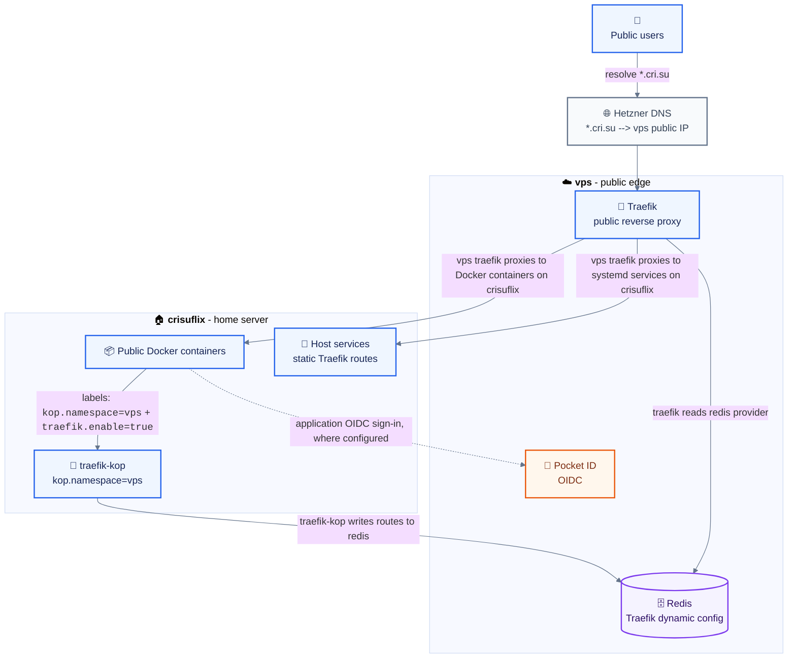
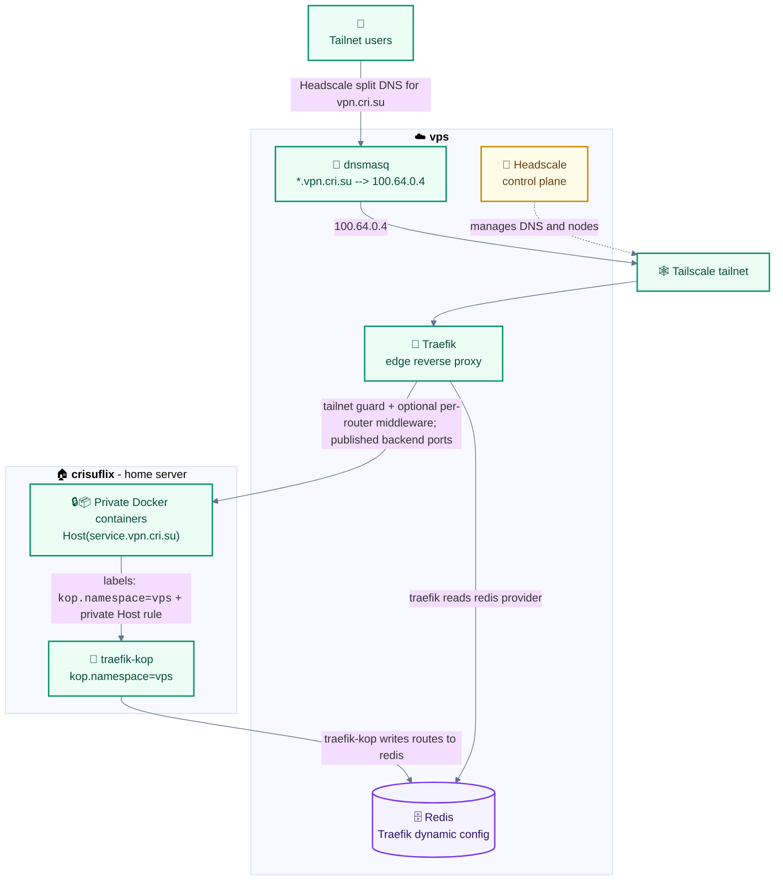

# NixOS Configuration

This is my (perhaps overly complex) nixconfig which covers basically all of my machines. Most of the configuration is AI generated.

My Docker Compose files are not available in this repo.

## Hosts

| Host        | Purpose               |
| ----------- | --------------------- |
| `laptop`    | Daily driver          |
| `vps`       | Public edge           |
| `crisuflix` | NAS and home services |
| `rpi5`      | Home Assistant kiosk  |

Notable pieces of software in my infrastructure that bring me joy (some of these are running as Docker containers and therefore not configured in this repo):

- **NixOS:** [hjem](https://github.com/feel-co/hjem), [hjem-impure](https://github.com/Rexcrazy804/hjem-impure), [disko](https://github.com/nix-community/disko), [agenix](https://github.com/ryantm/agenix), [mcp-nixos](https://github.com/utensils/mcp-nixos)
- **Storage:** [ZFS](https://openzfs.org/), [Sanoid](https://github.com/jimsalterjrs/sanoid), [Restic](https://restic.net/)
- **Media management:** [Jellyfin](https://jellyfin.org/), [SABnzbd](https://sabnzbd.org/), [Servarr](https://wiki.servarr.com/), [Grimmory](https://github.com/gabe565/grimmory), [Immich](https://immich.app/), [Beets](https://beets.io/)
- **Networks:** [Traefik](https://traefik.io/), [traefik-kop](https://github.com/jittering/traefik-kop), [Pocket ID](https://pocket-id.org/), [Tailscale](https://tailscale.com/), [Headscale](https://headscale.net/), [Headplane](https://github.com/tale/headplane)
- **Admin and monitoring:** [Dockge](https://dockge.kuma.pet/), [Gotify](https://gotify.net/), [Homepage](https://gethomepage.dev/), [Uptime Kuma](https://uptime.kuma.pet/), [Beszel](https://beszel.dev/)
- **Desktop environment:** [Niri](https://github.com/YaLTeR/niri), [Noctalia](https://github.com/noctalia-dev/noctalia), [Helix](https://helix-editor.com/), [Yazi](https://yazi-rs.github.io/), [Foot](https://codeberg.org/dnkl/foot), [Zen Browser](https://zen-browser.app/), [OpenCode](https://opencode.ai/)
- **Home automation:** [Home Assistant](https://www.home-assistant.io/), [Music Assistant](https://music-assistant.io/), [Frigate](https://frigate.video/)
- **Tools:** [OpenCloud](https://opencloud.eu/), [Anchor Notes](https://github.com/ZhFahim/anchor), [I Hate Money](https://ihatemoney.org/), [SparkyFitness](https://github.com/CodeWithCJ/SparkyFitness)

## Public And Tailnet Routing

Public `*.cri.su` services terminate at Traefik on `vps`. Selected Docker containers on `crisuflix` are published via [traefik-kop](https://github.com/jittering/traefik-kop) using Docker labels into Redis on `vps`, over the Headscale-managed Tailscale network. Kop runs with `NAMESPACE=vps` and `BIND_INTERFACE=tailscale0`; the edge Traefik reads those Redis routes and proxies back to published ports on `crisuflix` over the tailnet. Private Docker services use `*.vpn.cri.su`: Headscale sends that split-DNS zone to `dnsmasq` on `vps`, which wildcard-resolves it to the VPS tailnet IP. Pocket ID provides OIDC sign-in for applications configured to use it; it is not a global Traefik authentication middleware.

A centralized HTTPS guard also rejects non-tailnet clients for every `*.vpn.cri.su` hostname, including Redis-published routes without a middleware label. Its router priority `1000000` is reserved above all service routers; tailnet clients bypass the guard and use the normal service routes. Keep per-service `tailnet-only` middleware as defense in depth.

### Docker label and network conventions

Example private service (replace the hostname and ports for the application):

```yaml
services:
  app:
    ports:
      - "100.64.10.1:18080:8080"
    labels:
      - "kop.namespace=vps"
      - "traefik.enable=true"
      - "traefik.http.routers.app.rule=Host(`app.vpn.cri.su`)"
      - "traefik.http.routers.app.entrypoints=websecure"
      - "traefik.http.routers.app.middlewares=tailnet-only@file"
```

- `kop.namespace=vps` selects the container for the VPS kop instance. `traefik.instance=public` is a legacy label, not a selection requirement for this kop instance.
- Use `app.cri.su` for a public service and omit `tailnet-only@file` if public access is intended. Configure application authentication separately.
- With one published port, kop detects the host port automatically. With multiple ports, explicitly select the backend using `traefik.http.services.app.loadbalancer.server.port`. Current kop maps the selected container port to its published host port; older versions may differ. Host-networked services need an explicit listening port.
- `traefik.http.routers.app.service=app` is optional when there is only one service to select. Use it to disambiguate multiple services.
- The `websecure` entrypoint enables TLS and defaults to the `hetzner` resolver with wildcard certificates for `*.cri.su` and `*.vpn.cri.su`, so per-router `tls=true` and `tls.certresolver` labels are redundant. Backend HTTPS is separate: set `traefik.http.services.app.loadbalancer.server.scheme=https` only when the backend port speaks HTTPS.
- Use Compose-managed stack-specific bridge networks by default. VPS Traefik does not join those networks: backend ports must be published and reachable from the VPS; `expose:` alone is insufficient. Do not set `traefik.docker.network` for these ordinary bridges, since kop can then publish an address unreachable from the VPS.
- Share a dedicated external network only for intentional cross-stack traffic, such as `arr-stack` for Arr/NZBGet. NixOS provisions `arr-stack`, but no longer provisions `traefik-public` or `traefik-internal`. Docker persists networks across reboots; Compose recreates its own networks on `up`, whereas external networks must already exist. Container recovery also requires an appropriate restart policy.

### Public users accessing \*.cri.su



### Tailnet users accessing \*.vpn.cri.su



## OpenCode

OpenCode V2 runs as `llego` on `crisuflix`, sharing the normal user configuration,
credentials, and sessions. Its API and web UI are served through the VPS at
`https://opencode.vpn.cri.su`, with tailnet-only routing and built-in pairing
authentication. See [setup and client pairing](docs/opencode.md).

## Layout

| Path         | Purpose                     |
| ------------ | --------------------------- |
| `hosts/`     | Per-machine NixOS configs   |
| `modules/`   | Reusable NixOS modules      |
| `dots/`      | Userspace dotfiles          |
| `pkgs/`      | Custom packages             |
| `secrets/`   | agenix secrets              |
| `docs/`      | Long-form notes             |
| `HANDOFF.md` | Current state, next actions |

## Secrets

Secrets use [agenix](https://github.com/ryantm/agenix) and are encrypted to SSH host keys plus user keys from `secrets.nix`.

```bash
agenix -e secrets/initial-password.age
agenix -r
```

## Git Commit Signing

Git commits use one dedicated SSH signing key on every NixOS host. The private key is distributed through agenix as `git-signing-key.age`; Git is configured by `modules/core/default.nix` to sign commits automatically and verify signatures using `dots/git/allowed_signers`. The public key fingerprint is `SHA256:JP9GsAqW7bAaB7JH57MSA2i8RS3o+M92mq1oiQkvYLw`.

The public key must also be added to GitHub as an account signing key before GitHub can display commits as verified.

## Nixpkgs Policy

`nixpkgs` follows `nixos-unstable` by default. Use `pkgs-stable` for explicit stable package or service overrides. `rpi5` is the exception: it is built from `nixpkgs-stable` for safer remote Raspberry Pi updates.

## Custom Packages

Packages in `pkgs/` are standalone flakes with `inputs.nixpkgs.follows = "nixpkgs"`.

`pkgs/album-downloader` exposes both the cheap `album-downloader` shell wrapper and the expensive `bandsnatch` Rust package. `bandsnatch` keeps its own pinned dependency graph so root `nixpkgs` updates do not churn its store path. If that package flake changes, prime `llego.cachix.org` from inside the package flake before rebuilding clean hosts:

```bash
cd pkgs/album-downloader
nix build .#bandsnatch
cachix push llego ./result
```
